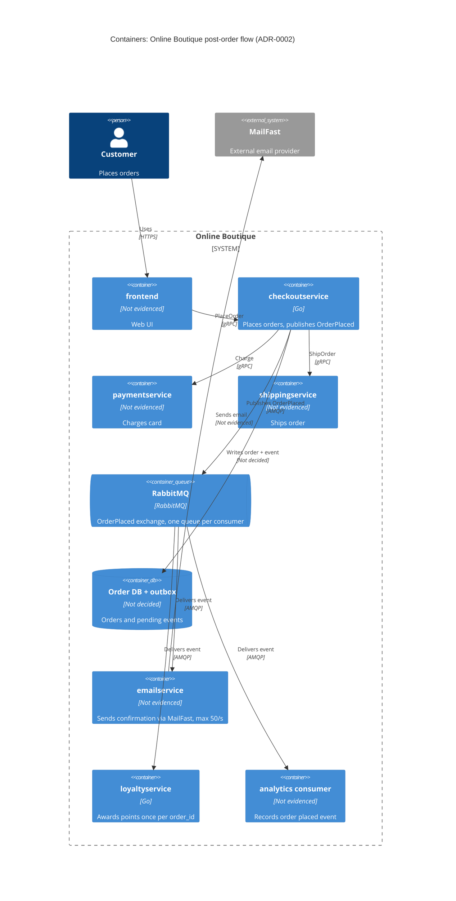

# ADR-0002: Publish an "OrderPlaced" event to RabbitMQ for post-order actions

- **Status:** Proposed
- **Date:** 2026-10-26
- **Deciders:** อภิมุข สาโรวาท (6631358621)

## Context and problem

Requirement R-12 (`docs/scenario.md`) กำหนดว่าหลังสั่งซื้อสำเร็จ ระบบต้อง (1) ส่งอีเมลยืนยันผ่าน **MailFast** (external provider ที่มาแทน logic จำลองของ `emailservice`) (2) ให้แต้ม loyalty ผ่าน `loyaltyservice` ตัวใหม่ (3) บันทึก analytics event "order placed" ให้ทีม marketing และปีหน้าจะมี post-order action เพิ่มอีก (SMS, fraud scoring, recommendations update)

**สภาพปัจจุบัน (จากโค้ด):**

| ข้อเท็จจริง | หลักฐาน |
|---|---|
| `PlaceOrder` เรียก `paymentservice` แล้ว `shippingservice` แบบ synchronous gRPC ตามลำดับ | `system/online-boutique/src/checkoutservice/main.go` (`PlaceOrder`, บรรทัด 252–261: `chargeCard`, `shipOrder`) |
| ส่งอีเมลแบบ synchronous หลังจากนั้น ถ้าล้มเหลวแค่ log warning และ order ยังสำเร็จ | `main.go` บรรทัด 273–277 (`sendOrderConfirmation` → `log.Warnf`) |
| ทุก downstream ถูก hard-wire ด้วย env var + gRPC connection ใน `checkoutService` struct | `main.go` บรรทัด 66–86, 111–123 (`EMAIL_SERVICE_ADDR`, `mustConnGRPC`) |
| `orderID` สร้างด้วย UUID ภายใน `PlaceOrder` (ใช้เป็น idempotency key ได้) | `main.go` บรรทัด 233 (`uuid.NewUUID()`) |
| `checkoutservice` ไม่มี data store ของตัวเอง (import มีแค่ gRPC/OTel/logrus) จึงไม่ได้ persist order | `main.go` บรรทัด 17–43 |

**ตัวเลขที่สำคัญ (`docs/scenario.md`):**

- p95 ของ `PlaceOrder` ต้อง **≤ 500 ms** (ปัจจุบันประมาณ 300 ms) → เหลือ budget ประมาณ 200 ms
- MailFast: p95 **1.5 s**, p99 **8 s**, fail ประมาณ **0.5 %**, rate limit **50 emails/s**
- Peak **200 orders/s** (11.11) → มากกว่า rate limit ของ MailFast 4 เท่า; backlog โตประมาณ **150 emails/s** (ประมาณ 9,000 อีเมลต่อนาทีของ peak)
- Loyalty: ต้องให้แต้ม **ภายใน 1 นาที** และ **exactly once**
- Availability: order **ต้องไม่ fail** เพราะ email, loyalty หรือ analytics ล่ม

**ปัญหา:** ถ้าเพิ่ม 3 action (และอีกหลายตัวปีหน้า) เป็น synchronous call ใน `PlaceOrder` แค่ MailFast ตัวเดียว (p95 1.5 s) ก็ทำให้ p95 เกิน 500 ms แน่นอน, ต้องรอทุก provider, และต้องแก้ `checkoutservice` ทุกครั้งที่มี action ใหม่ เราจะเชื่อม checkout กับ post-order actions อย่างไร?

## Decision drivers

1. **Availability:** order ต้องสำเร็จแม้ email / loyalty / analytics / MailFast ล่ม
2. **Performance (latency):** p95 `PlaceOrder` ≤ 500 ms ที่ 200 orders/s
3. **Reliability / correctness:** loyalty ต้อง exactly once ภายใน 1 นาที; อีเมลไม่ควรหายเพราะ MailFast fail 0.5 % หรือติด rate limit
4. **Modifiability (extensibility):** เพิ่ม SMS, fraud scoring, recommendations ปีหน้าโดยไม่ต้องแก้ `checkoutservice`
5. **Team fit & operations:** ทีม 4 คน เก่ง Go/gRPC, 2 คนเคยใช้ RabbitMQ; ทุกอย่างรันบน Kubernetes; ชอบ open-source self-hosted มากกว่า managed cloud
6. **Cost / simplicity:** ไม่เพิ่ม component เกินที่จำเป็น

## Considered options

1. **Synchronous gRPC calls เพิ่มใน `PlaceOrder`** (ขยายแบบเดิม: เรียก email→MailFast, `loyaltyservice`, analytics ตามลำดับหรือขนานกันพร้อม timeout)
2. **In-process async ใน `checkoutservice`** (ยิง goroutine หลังตอบ order แล้ว พร้อม retry ในหน่วยความจำ)
3. **Event-driven ผ่าน RabbitMQ (self-hosted บน Kubernetes):** `checkoutservice` publish event `OrderPlaced` ไป fanout/topic exchange; แต่ละ consumer (`emailservice`→MailFast, `loyaltyservice`, analytics) มี queue ของตัวเอง
4. **Event-driven ผ่าน Apache Kafka (self-hosted):** publish `OrderPlaced` ลง topic; consumer แต่ละตัวเป็น consumer group แยกกัน

### Pros and cons of the options

| Option | Pros | Cons |
|---|---|---|
| 1. Sync gRPC | เข้าใจง่าย, ตรงกับ skill ทีม (Go/gRPC), ไม่มี component ใหม่, รู้ผลทันที | MailFast p95 1.5 s ทำให้ p95 เกิน 500 ms แม้เรียกขนาน; timeout สั้นจะทำให้อีเมลหาย; ชน rate limit 50/s ที่ peak 200/s; ต้องแก้ checkout ทุกครั้งที่มี action ใหม่ (coupling สูง) |
| 2. In-process async | latency ของ `PlaceOrder` ไม่เพิ่ม; ไม่มี component ใหม่ | งานในหน่วยความจำหายเมื่อ pod restart/scale down → ไม่รับประกันอีเมลหรือแต้ม; backlog 150/s ช่วง peak กองใน memory ของ checkout; exactly once ทำได้ยาก; ยังต้องแก้ checkout ทุก action ใหม่ |
| 3. RabbitMQ | ตัด latency ของ post-order ออกจาก checkout (publish เป็นเวลาไม่กี่ ms **[Inferred]**); queue ทนทาน buffer backlog ช่วง 11.11 แล้วทยอยส่งตาม 50 emails/s; queue แยกต่อ consumer ทำให้อีเมลค้างไม่ทำให้ loyalty ช้า; เพิ่ม consumer ใหม่ได้โดยไม่แก้ checkout; open-source self-hosted บน K8s; ทีม 2 คนเคยใช้ | เพิ่ม stateful component ที่ต้อง operate (cluster, monitoring); delivery เป็น at-least-once → ต้องทำ idempotency ฝั่ง consumer; อีเมลส่งช้ากว่าเดิม (eventual); publish อาจ fail หลังตัดเงินแล้ว (checkout ไม่มี DB สำหรับ outbox) |
| 4. Kafka | throughput สูง, เก็บ event ย้อนหลัง/replay ได้ดีสำหรับ analytics; consumer group แยกต่อ action; open-source | ทีมไม่มีประสบการณ์ (ไม่ evidenced ใน context); operate ยากกว่าสำหรับทีม 4 คน; 200 msg/s ไม่ต้องการ throughput ระดับ Kafka; การ throttle ต่อ consumer (50/s) และ retry/DLQ ต้องสร้างเองมากกว่า |

## Decision

เลือก **Option 3: publish event `OrderPlaced` ไปยัง RabbitMQ (self-hosted บน Kubernetes)**

- หลัง `shipOrder` สำเร็จ `checkoutservice` publish `OrderPlaced` (มี `order_id` จาก `uuid.NewUUID()`, email, items, total) ไปยัง exchange เดียว แล้วตอบ client ทันที ถ้า publish fail ให้ retry สั้น ๆ แล้ว log error **โดยไม่ทำให้ order fail** (คงพฤติกรรมเดียวกับ `main.go` บรรทัด 273–277)
- แต่ละ action มี durable queue ของตัวเอง:
  - `emailservice` (เปลี่ยน logic จำลองเป็นเรียก MailFast) consume โดย **จำกัดอัตรา ≤ 50 emails/s** พร้อม retry + backoff และ dead-letter queue
  - `loyaltyservice` (Go/gRPC ใหม่) consume และ **dedupe ด้วย `order_id`** (เช่น unique constraint ในที่เก็บแต้ม) เพื่อให้ได้ผลแบบ exactly once บน at-least-once delivery
  - analytics consumer บันทึก event "order placed"
- ลบ dependency `EMAIL_SERVICE_ADDR` ออกจาก `checkoutservice` (`main.go` บรรทัด 115, 122) เพราะ checkout ไม่ต้องรู้จัก consumer อีกต่อไป
- จะใช้ order DB + transactional outbox เพื่อไม่ให้ event หาย

**เหตุผล:** เป็นตัวเลือกเดียวที่ผ่านทั้ง driver 1–4 พร้อมกัน: แยก latency และ failure ของ MailFast ออกจาก checkout, buffer ส่วนต่าง 200 vs 50/s ช่วง peak, ทำให้ action ใหม่ปีหน้าเป็นแค่ queue + consumer ใหม่ และเลือก RabbitMQ แทน Kafka เพราะทีมมีประสบการณ์และ load 200 msg/s ไม่ต้องการความสามารถของ Kafka (driver 5–6)

หมายเหตุ: ภาษาของ `paymentservice`/`frontend` และ protocol ของ MailFast ไม่ evidenced ในไฟล์ context; ที่ใส่ไว้ใน diagram สำหรับ `frontend`, `paymentservice`, `shippingservice` เป็น **[Inferred]**

## Consequences

- **Positive:** `PlaceOrder` ไม่ต้องรอ MailFast/loyalty/analytics → p95 คาดว่าใกล้ 300 ms เดิม บวก publish (performance) **[Inferred]**
- **Positive:** MailFast, `loyaltyservice` หรือ analytics ล่มไม่ทำให้ order fail; message รอใน queue จนกว่า consumer กลับมา (availability)
- **Positive:** queue ดูดซับ backlog ช่วง 11.11 และ consumer ส่งอีเมลตาม rate limit 50/s; retry ครอบคลุม MailFast fail 0.5 % (reliability)
- **Positive:** SMS, fraud scoring, recommendations ปีหน้า = เพิ่ม queue + consumer ใหม่ โดยไม่แก้ `checkoutservice` (modifiability)
- **Positive:** ใช้ open-source self-hosted บน K8s ตามนโยบาย และทีมมีคนเคยใช้ RabbitMQ (cost / operability)
- **Negative:** มี stateful component ใหม่ต้อง deploy, monitor, upgrade และเป็นจุดล้มเหลวร่วมของ post-order actions (operability, availability)
- **Negative:** ทีม 4 คนต้องดูแล DB อีกตัว และทุก order ต้องเขียน DB เพิ่มหนึ่งครั้ง ซึ่งทำให้ checkout ช้าลงเล็กน้อย (quality attribute: performance,cost,operability)
- **Negative:** อีเมลเป็น eventual: ช่วง peak 200 orders/s อีเมลจะค้างเพิ่มประมาณ 150 ฉบับ/วินาที ลูกค้าอาจได้อีเมลช้าเป็นนาทีถึงชั่วโมง ขึ้นกับความยาวของ peak (performance ที่ผู้ใช้รับรู้)
- **Negative:** at-least-once delivery บังคับให้ทุก consumer ต้อง idempotent; debug flow ข้าม service ยากขึ้น (modifiability, testability)
- **Risks and mitigations:**
  - *Publish fail หลังตัดเงินแล้ว → event หาย (ไม่มีอีเมล ไม่มีแต้ม):* `checkoutservice` ไม่มี DB สำหรับ transactional outbox (`main.go` บรรทัด 17–43) → เพิ่ม DB ให้ checkoutservice บันทึก order และ event ใน transaction เดียวกัน แล้วให้ตัวส่งแยกต่างหากอ่านจาก outbox ไปส่งที่ RabbitMQ เพราะ scenario บังคับว่าแต้มต้องได้ภายใน 1 นาที และห้ามหาย
  - *Loyalty ได้แต้มซ้ำจาก redelivery:* dedupe ด้วย `order_id` ใน `loyaltyservice`
  - *Loyalty เกิน 1 นาทีช่วง peak:* queue แยกจากอีเมล, scale consumer ของ loyalty, ตั้ง alert บน queue age
  - *RabbitMQ ล่ม:* รันเป็น cluster แบบ quorum queues บน K8s **[Inferred]**; ระหว่างล่ม checkout ยังรับ order ได้ (ตาม driver 1) แต่ event อาจหาย → ดูความเสี่ยงข้อแรก
  - *Message ที่ fail ซ้ำ (เช่น อีเมลไม่ถูกต้อง):* dead-letter queue + dashboard

## Validation

- **Load test** (เช่น Locust ตามแนวทาง ADR-0001) ที่ **200 orders/s**: p95 `PlaceOrder` ≤ 500 ms ขณะ MailFast ถูก stub ให้มี p95 1.5 s / p99 8 s / error 0.5 %
- **Fault injection:** ปิด `emailservice`, `loyaltyservice`, analytics consumer และ MailFast ทีละตัว → order ต้องสำเร็จ 100 % และ message ต้องถูก process ครบหลัง service กลับมา
- **Loyalty:** วัด lag จาก order ถึงแต้มเข้า ≤ 1 นาทีที่ peak; redeliver event ซ้ำโดยตั้งใจ → แต้มต้องไม่ซ้ำ (0 duplicates)
- **Email:** อัตราส่งไป MailFast ไม่เกิน 50/s; วัดเวลาที่ queue ว่างหลัง peak
- **Review date:** ทบทวนหลัง 11.11 ครั้งแรก หรือก่อนเพิ่ม consumer ตัวแรกของปีหน้า

## Open questions

- **ระยะเวลาของ peak 11.11:** ไม่ทราบ จึงคำนวณ backlog อีเมลรวมและเวลาที่ queue จะว่างไม่ได้
- **SLA ของอีเมล:** ลูกค้ายอมรับอีเมลยืนยันช้าได้นานเท่าไร? ถ้ามีเพดาน อาจต้องเจรจาเพิ่ม rate limit กับ MailFast หรือจัด priority
- **MailFast:** protocol/API, มี idempotency key หรือไม่ (กันอีเมลซ้ำเมื่อ retry), และค่าใช้จ่ายต่อฉบับ: ไม่ evidenced
- **ที่เก็บข้อมูลของ `loyaltyservice`:** ใช้อะไรเก็บแต้มและ dedupe key? ไม่ได้ระบุ
- **Analytics:** ปลายทางของ event คืออะไร (ระบบของ marketing, data warehouse)? ต้องเก็บย้อนหลัง/replay ไหม? (ถ้าต้องการ replay มาก อาจทบทวน Kafka)
- **ทรัพยากร operations:** ใครดูแล RabbitMQ บน production และมี monitoring stack อะไรอยู่แล้ว: ไม่ evidenced
- **Fraud scoring ปีหน้า:** ถ้าต้องตัดสินก่อนยืนยัน order (blocking) จะไม่เข้ากับ async model นี้ ต้องตัดสินใจแยก
