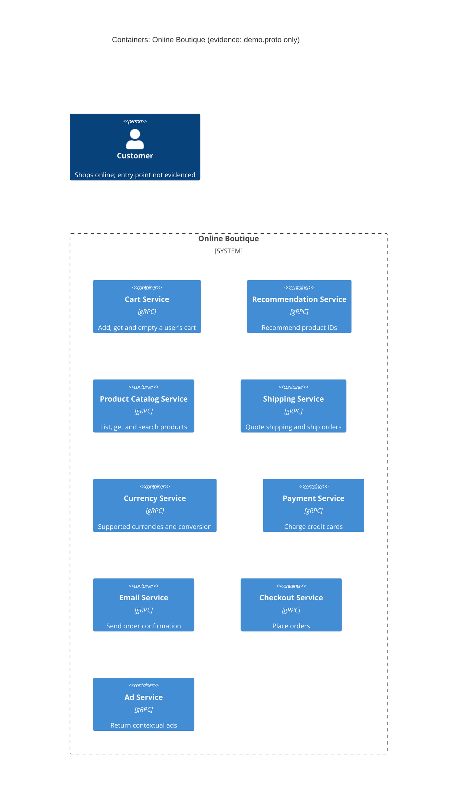

# Task 1A: Recovered architecture (evidence: `protos/demo.proto` only)

## 1. Agent

Claude Code (Anthropic), model Claude Opus 5.5 (`claude-opus-5-5`).

## 2. Files read

- `AGENTS.md` (repository rules)
- `prompts/1-recover-architecture.md` (task file)
- `system/online-boutique/protos/demo.proto` (only evidence file)

## 3. Containers table

`demo.proto` defines gRPC service interfaces (`package hipstershop`). It does **not** show the implementation language of any service. All services expose gRPC/Protocol Buffers (`syntax = "proto3"`, line 15).

| Container | Technology / language | Responsibility (from RPCs) | Evidence |
|---|---|---|---|
| Cart Service | gRPC (proto3); language not evidenced | Add items, get cart, empty cart per `user_id` | `system/online-boutique/protos/demo.proto` (`service CartService`, l.23-27) |
| Recommendation Service | gRPC (proto3); language not evidenced | Return recommended product IDs for a user and a list of products | `system/online-boutique/protos/demo.proto` (`service RecommendationService`, l.56-58) |
| Product Catalog Service | gRPC (proto3); language not evidenced | List, get and search products (`Product` with price, categories) | `system/online-boutique/protos/demo.proto` (`service ProductCatalogService`, l.71-75) |
| Shipping Service | gRPC (proto3); language not evidenced | Shipping quote for address + items; ship order, return tracking ID | `system/online-boutique/protos/demo.proto` (`service ShippingService`, l.107-110) |
| Currency Service | gRPC (proto3); language not evidenced | List supported currencies; convert `Money` between ISO 4217 currencies | `system/online-boutique/protos/demo.proto` (`service CurrencyService`, l.140-143) |
| Payment Service | gRPC (proto3); language not evidenced | Charge a credit card, return `transaction_id` | `system/online-boutique/protos/demo.proto` (`service PaymentService`, l.177-179) |
| Email Service | gRPC (proto3); language not evidenced | Send order confirmation to an email address | `system/online-boutique/protos/demo.proto` (`service EmailService`, l.199-201) |
| Checkout Service | gRPC (proto3); language not evidenced | Place an order (user, currency, address, email, card) and return `OrderResult` | `system/online-boutique/protos/demo.proto` (`service CheckoutService`, l.224-226) |
| Ad Service | gRPC (proto3); language not evidenced | Return ads for page context keywords | `system/online-boutique/protos/demo.proto` (`service AdService`, l.243-245) |

No data stores, message brokers, frontend/web container or external systems are evidenced in `demo.proto`.

## 4. Dependencies table

A `.proto` file declares which RPCs each service **offers**. It does not declare which service **calls** which. So no runtime dependency is evidenced.

| Caller → Callee | Protocol | Evidence |
|---|---|---|
| None evidenced | – | Not evidenced in the provided files |

Candidate dependencies that the message types suggest but do not prove are listed under **Gaps**.

## 5. Mermaid diagram

The diagram matches the tables: 9 containers, no `Rel` because no dependency is evidenced. The end user is shown as required, but the evidence doesn't show which container they use, so they have no `Rel` either.

## 6. Gaps

| Gap | Why it is open | File that would settle it |
|---|---|---|
| Which service calls which (all runtime dependencies) | `.proto` only defines interfaces, not clients | `system/online-boutique/kubernetes-manifests/*.yaml` (`*_SERVICE_ADDR` env vars), or each service's source in `system/online-boutique/src/` |
| **[Inferred]** Checkout Service → Payment, Shipping, Email, Cart, Currency, Product Catalog | `PlaceOrderRequest` carries `CreditCardInfo`, `Address`, `email`, `user_currency` (l.228-235); `OrderResult` holds `shipping_tracking_id`, `shipping_cost`, `OrderItem.cost` (l.208-214). These match `ChargeRequest`, `ShipOrderResponse`, `SendOrderConfirmationRequest`, `Money`/`Convert` and `Cart`, but the calls themselves are not shown | `system/online-boutique/src/checkoutservice/` source, `kubernetes-manifests/checkoutservice.yaml` |
| **[Inferred]** Recommendation Service → Product Catalog Service | Both deal in `product_ids`; no call is shown | `system/online-boutique/src/recommendationservice/`, its manifest |
| A frontend / web UI container and how the Customer reaches the system (protocol, e.g. HTTP) | No frontend service in the proto; `AdRequest.context_keys` mentions "the current page" (l.248), suggesting a page-rendering client **[Inferred]** | `system/online-boutique/kubernetes-manifests/frontend.yaml`, `src/frontend/` |
| Implementation language/technology of each service | `.proto` is language-neutral (only `go_package` option, l.19, which names a Go package path for generated code, not the service language) | Each `src/<service>/` folder (Dockerfile, source files) |
| Data stores (e.g. where carts are persisted) | No storage in the proto | `src/cartservice/`, `kubernetes-manifests/` (e.g. a cache/database deployment) |
| External systems (real payment provider, email server) | Not evidenced; `PaymentService`/`EmailService` may be stubs or proxies | `src/paymentservice/`, `src/emailservice/` |
| Message brokers / async messaging | None in the proto; all interfaces are unary gRPC RPCs | Manifests and service source |
