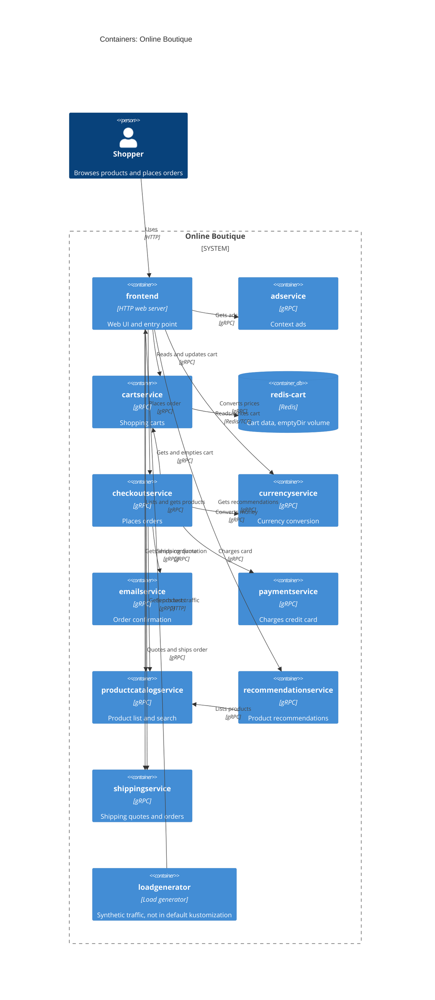

# Task 1, run B: Recovered C4 container architecture of Online Boutique

Evidence allowed: `system/online-boutique/protos/demo.proto`, `system/online-boutique/kubernetes-manifests/`

## 1. Agent

Claude Code (Anthropic), model Claude Opus 5.5 (`claude-opus-5-5`).

## 2. Files read

- `prompts/1-recover-architecture.md` (task file)
- `system/online-boutique/protos/demo.proto`
- `system/online-boutique/kubernetes-manifests/kustomization.yaml`
- `system/online-boutique/kubernetes-manifests/README.md`
- `system/online-boutique/kubernetes-manifests/frontend.yaml`
- `system/online-boutique/kubernetes-manifests/adservice.yaml`
- `system/online-boutique/kubernetes-manifests/cartservice.yaml`
- `system/online-boutique/kubernetes-manifests/checkoutservice.yaml`
- `system/online-boutique/kubernetes-manifests/currencyservice.yaml`
- `system/online-boutique/kubernetes-manifests/emailservice.yaml`
- `system/online-boutique/kubernetes-manifests/paymentservice.yaml`
- `system/online-boutique/kubernetes-manifests/productcatalogservice.yaml`
- `system/online-boutique/kubernetes-manifests/recommendationservice.yaml`
- `system/online-boutique/kubernetes-manifests/shippingservice.yaml`
- `system/online-boutique/kubernetes-manifests/loadgenerator.yaml`
- Attempted, does not exist: `system/online-boutique/kubernetes-manifests/shoppingassistantservice.yaml`

Note: I could not list the directory without a terminal command, so I opened files by the names listed in `kustomization.yaml` (`resources`, plus the commented-out `loadgenerator.yaml`) and `README.md`. Other files in the folder, if any, were not read.

## 3. Containers table

Implementation languages are **Not evidenced in the provided files**: the manifests only give image names (e.g. `image: frontend`), and the proto file is language-neutral.

| Container | Technology / language | Responsibility | Evidence |
|---|---|---|---|
| `frontend` | HTTP web server, port 8080; language not evidenced | Web UI and entry point for shoppers; calls the backend services | `kubernetes-manifests/frontend.yaml` (Deployment `frontend`, `httpGet /_healthz`, Service `frontend-external` type `LoadBalancer`, port `http` 80→8080) |
| `adservice` | gRPC server, port 9555; language not evidenced | Returns text ads for context keywords (`GetAds`) | `kubernetes-manifests/adservice.yaml` (Service port `grpc` 9555); `protos/demo.proto` (`service AdService`) |
| `cartservice` | gRPC server, port 7070; language not evidenced | Stores and returns users' shopping carts (`AddItem`, `GetCart`, `EmptyCart`) | `kubernetes-manifests/cartservice.yaml` (Service port `grpc` 7070); `protos/demo.proto` (`service CartService`) |
| `redis-cart` | Redis (`redis:alpine`), port 6379 | Cart data store; data on an `emptyDir` volume (not persistent across pod restarts) | `kubernetes-manifests/cartservice.yaml` (Deployment `redis-cart`, `image: redis:alpine`, volume `redis-data: emptyDir`) |
| `checkoutservice` | gRPC server, port 5050; language not evidenced | Orchestrates order placement (`PlaceOrder`) | `kubernetes-manifests/checkoutservice.yaml` (Service port `grpc` 5050); `protos/demo.proto` (`service CheckoutService`) |
| `currencyservice` | gRPC server, port 7000; language not evidenced | Lists supported currencies and converts money (`GetSupportedCurrencies`, `Convert`) | `kubernetes-manifests/currencyservice.yaml` (Service port `grpc` 7000); `protos/demo.proto` (`service CurrencyService`) |
| `emailservice` | gRPC server, container port 8080, Service port 5000; language not evidenced | Sends order confirmation (`SendOrderConfirmation`) | `kubernetes-manifests/emailservice.yaml` (Service port `grpc` 5000→8080); `protos/demo.proto` (`service EmailService`) |
| `paymentservice` | gRPC server, port 50051; language not evidenced | Charges a credit card, returns transaction id (`Charge`) | `kubernetes-manifests/paymentservice.yaml` (Service port `grpc` 50051); `protos/demo.proto` (`service PaymentService`) |
| `productcatalogservice` | gRPC server, port 3550; language not evidenced | Lists, gets and searches products (`ListProducts`, `GetProduct`, `SearchProducts`) | `kubernetes-manifests/productcatalogservice.yaml` (Service port `grpc` 3550); `protos/demo.proto` (`service ProductCatalogService`) |
| `recommendationservice` | gRPC server, port 8080; language not evidenced | Recommends product ids (`ListRecommendations`) | `kubernetes-manifests/recommendationservice.yaml` (Service port `grpc` 8080); `protos/demo.proto` (`service RecommendationService`) |
| `shippingservice` | gRPC server, port 50051; language not evidenced | Shipping quotes and shipping orders (`GetQuote`, `ShipOrder`) | `kubernetes-manifests/shippingservice.yaml` (Service port `grpc` 50051); `protos/demo.proto` (`service ShippingService`) |
| `loadgenerator` | Load generator (image `loadgenerator`); language not evidenced | Generates synthetic user traffic against the frontend (`USERS=10`, `RATE=1`). Commented out of `kustomization.yaml`, so not part of the default deployment | `kubernetes-manifests/loadgenerator.yaml` (Deployment `loadgenerator`, `FRONTEND_ADDR`); `kubernetes-manifests/kustomization.yaml` (`# - loadgenerator.yaml`) |

## 4. Dependencies table

gRPC as the protocol is shown by the Service port name `grpc` and the `grpc` readiness/liveness probes in each callee manifest, together with the `service` definitions in `protos/demo.proto`.

| Caller → callee | Protocol | Evidence |
|---|---|---|
| Shopper → `frontend` | HTTP | `kubernetes-manifests/frontend.yaml` (Service `frontend-external`, `type: LoadBalancer`, port `http` 80) |
| `loadgenerator` → `frontend` | HTTP | `kubernetes-manifests/loadgenerator.yaml` (`FRONTEND_ADDR=frontend:80`, `wget http://${FRONTEND_ADDR}`) |
| `frontend` → `productcatalogservice` | gRPC | `kubernetes-manifests/frontend.yaml` (`PRODUCT_CATALOG_SERVICE_ADDR=productcatalogservice:3550`) |
| `frontend` → `currencyservice` | gRPC | `kubernetes-manifests/frontend.yaml` (`CURRENCY_SERVICE_ADDR=currencyservice:7000`) |
| `frontend` → `cartservice` | gRPC | `kubernetes-manifests/frontend.yaml` (`CART_SERVICE_ADDR=cartservice:7070`) |
| `frontend` → `recommendationservice` | gRPC | `kubernetes-manifests/frontend.yaml` (`RECOMMENDATION_SERVICE_ADDR=recommendationservice:8080`) |
| `frontend` → `shippingservice` | gRPC | `kubernetes-manifests/frontend.yaml` (`SHIPPING_SERVICE_ADDR=shippingservice:50051`) |
| `frontend` → `checkoutservice` | gRPC | `kubernetes-manifests/frontend.yaml` (`CHECKOUT_SERVICE_ADDR=checkoutservice:5050`) |
| `frontend` → `adservice` | gRPC | `kubernetes-manifests/frontend.yaml` (`AD_SERVICE_ADDR=adservice:9555`) |
| `checkoutservice` → `productcatalogservice` | gRPC | `kubernetes-manifests/checkoutservice.yaml` (`PRODUCT_CATALOG_SERVICE_ADDR=productcatalogservice:3550`) |
| `checkoutservice` → `shippingservice` | gRPC | `kubernetes-manifests/checkoutservice.yaml` (`SHIPPING_SERVICE_ADDR=shippingservice:50051`) |
| `checkoutservice` → `paymentservice` | gRPC | `kubernetes-manifests/checkoutservice.yaml` (`PAYMENT_SERVICE_ADDR=paymentservice:50051`) |
| `checkoutservice` → `emailservice` | gRPC | `kubernetes-manifests/checkoutservice.yaml` (`EMAIL_SERVICE_ADDR=emailservice:5000`) |
| `checkoutservice` → `currencyservice` | gRPC | `kubernetes-manifests/checkoutservice.yaml` (`CURRENCY_SERVICE_ADDR=currencyservice:7000`) |
| `checkoutservice` → `cartservice` | gRPC | `kubernetes-manifests/checkoutservice.yaml` (`CART_SERVICE_ADDR=cartservice:7070`) |
| `recommendationservice` → `productcatalogservice` | gRPC | `kubernetes-manifests/recommendationservice.yaml` (`PRODUCT_CATALOG_SERVICE_ADDR=productcatalogservice:3550`) |
| `cartservice` → `redis-cart` | Redis protocol over TCP | `kubernetes-manifests/cartservice.yaml` (`REDIS_ADDR=redis-cart:6379`; Service port `tcp-redis`) |

## 5. Mermaid diagram

## 6. Gaps

| Gap | Why it is open | File that would settle it |
|---|---|---|
| Implementation language of every service | Manifests give only image names; the proto is language-neutral | Each service's source folder or `Dockerfile` under `system/online-boutique/src/<service>/` |
| Which RPCs each caller actually uses | Env vars show *that* a caller has an address, not *which* methods it calls. The labels on `Rel` are inferred from method names in `demo.proto` **[Inferred]** | Caller source code, e.g. `src/frontend/` and `src/checkoutservice/` |
| `frontend` → `shoppingassistantservice` (`SHOPPING_ASSISTANT_SERVICE_ADDR=shoppingassistantservice:80`) | No manifest exists for it in this folder; it sits behind the commented-out component `../kustomize/components/shopping-assistant`. Left out of the diagram | `system/online-boutique/kustomize/components/shopping-assistant/` |
| Whether `emailservice` really sends email, and whether `paymentservice` calls a real payment provider | No external endpoint, SMTP host or API key appears in any manifest, so no `System_Ext` is drawn | `src/emailservice/` and `src/paymentservice/` source |
| Data store of `productcatalogservice`, `adservice`, `currencyservice` | No database env var or volume; the data may be bundled in the image **[Inferred]** | Service source code, e.g. `src/productcatalogservice/` |
| Alternative data stores (Memorystore, AlloyDB, Spanner) | Only named in commented-out `components` in `kustomization.yaml` | `system/online-boutique/kustomize/components/{memorystore,alloydb,spanner}/` |
| Optional `PACKAGING_SERVICE_URL` external service | Commented out in `frontend.yaml`; not active | `src/frontend/` source |
| Any asynchronous messaging (queues, brokers) | No broker appears in the manifests; all evidenced calls are synchronous gRPC/HTTP | Not evidenced in the provided files |
| Other files in `kubernetes-manifests/` | Folder could not be listed without a terminal command | Directory listing of `system/online-boutique/kubernetes-manifests/` |
