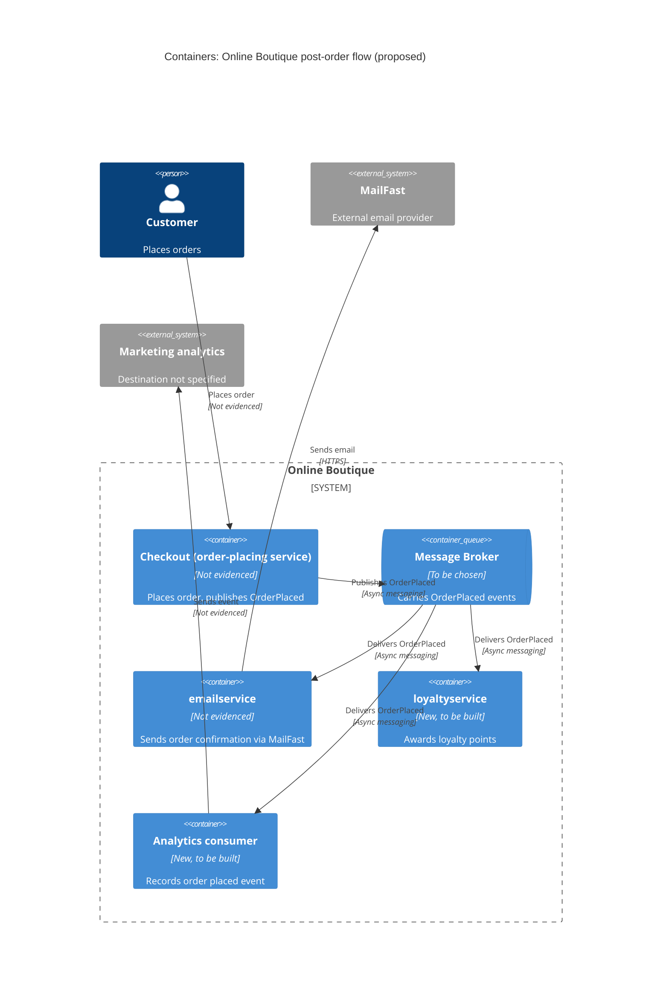

> Agent: Claude Code · Model: Claude Opus 5.5 (`claude-opus-5-5`) · Run: a (zero-shot, context: none)

# ADR-0002: ใช้ event "order placed" ผ่าน message broker เพื่อกระจาย post-order actions

- **Status:** Proposed
- **Date:** 2026-10-26
- **Deciders:** ทีมสถาปัตยกรรม Online Boutique (ยังไม่ระบุรายชื่อ ดู Open questions)

## Context and problem

หลังจากลูกค้าสั่งซื้อสำเร็จ Online Boutique ต้องทำงานต่อไปนี้ (จาก requirement):

1. ส่ง email ยืนยันคำสั่งซื้อผ่าน **MailFast** ซึ่งเป็น external email provider ใหม่ แทน logic mock ใน `emailservice`
2. ให้ loyalty points ผ่าน `loyaltyservice` ใหม่ (ยังต้องสร้าง)
3. บันทึก analytics event "order placed" ให้ทีม marketing

นอกจากนี้ marketing คาดว่าปีหน้าจะมี post-order actions เพิ่มอีก (SMS, fraud scoring, การอัปเดต recommendations)

ปัญหาที่ต้องตัดสินใจ: **service ที่ปิดคำสั่งซื้อควรเชื่อมกับ post-order actions เหล่านี้อย่างไร** ให้เพิ่ม consumer ใหม่ได้ง่าย และให้ความล้มเหลวของระบบภายนอก (เช่น MailFast) ไม่ทำให้การสั่งซื้อล้มเหลว

ข้อจำกัดเรื่องหลักฐาน: task นี้รันด้วย `context: none` จึงไม่ได้อ่าน source code ของระบบ ข้อมูลต่อไปนี้ **Not evidenced in the provided files**: service ไหนเป็นผู้ประสานการ checkout, ปัจจุบันเรียก `emailservice` ด้วย protocol อะไร (sync หรือ async), มี message broker อยู่แล้วหรือไม่, และตัวเลข traffic/latency ใดๆ
- **[Inferred]** ชื่อ `emailservice` และ "order placed" บ่งว่ามี service checkout ที่เรียก `emailservice` ตรงๆ หลังสั่งซื้อ ต้องยืนยันกับ code ก่อนรับ ADR นี้

## Decision drivers

เรียงจากสำคัญมากไปน้อย (ลำดับเป็นข้อเสนอ ยังไม่ได้ยืนยันกับ stakeholder):

- **Modifiability / extensibility:** เพิ่ม post-order action ใหม่ (SMS, fraud scoring, recommendations) ได้โดยไม่ต้องแก้ service ที่ปิดคำสั่งซื้อทุกครั้ง (requirement ระบุว่าจะมีเพิ่มปีหน้า)
- **Availability ของการสั่งซื้อ:** ถ้า MailFast, `loyaltyservice` หรือ analytics ล่ม ลูกค้าต้องยังสั่งซื้อได้
- **Performance (checkout latency):** post-order actions ไม่ควรเพิ่ม latency ที่ลูกค้ารับรู้ตอนกด place order
- **Reliability:** แต่ละ action ต้องเกิดขึ้นจริง (เช่น ไม่ให้ loyalty points หาย) และไม่ซ้ำโดยไม่ตั้งใจ (เช่น ไม่ให้แต้มซ้ำ)
- **Operability / cost:** จำนวนชิ้นส่วนใหม่ที่ทีมต้องดูแล

## Considered options

1. **A: Synchronous fan-out** — service ที่ปิดคำสั่งซื้อเรียก MailFast adapter (`emailservice`), `loyaltyservice` และ analytics ทีละตัวโดยตรง (เช่น ผ่าน gRPC/HTTP)
2. **B: Event-driven publish/subscribe** — service ที่ปิดคำสั่งซื้อ publish event `OrderPlaced` เพียงครั้งเดียวไปยัง message broker (เช่น RabbitMQ, Kafka หรือ cloud Pub/Sub ยังไม่เลือก) แต่ละ consumer (`emailservice` → MailFast, `loyaltyservice`, analytics) subscribe เองและประมวลผลแบบ asynchronous
3. **C: Orchestrator service ใหม่ (`postorderservice`)** — service ที่ปิดคำสั่งซื้อเรียก orchestrator ตัวเดียว แล้ว orchestrator เรียกแต่ละ action เอง (sync หรือ background jobs)

### Pros and cons of the options

| Option | Pros | Cons |
|---|---|---|
| A: Synchronous fan-out | ง่าย ไม่มี infrastructure ใหม่; error ส่งกลับทันที; trace ง่าย | coupling สูง: action ใหม่แต่ละตัวต้องแก้และ deploy service ที่ปิดคำสั่งซื้อ (modifiability ต่ำ); latency ของ checkout = ผลรวมของทุก call; ถ้า MailFast ช้า/ล่ม การสั่งซื้ออาจล้มหรือช้า (availability ต่ำ); ต้องเขียน retry เองในทุกจุด |
| B: Event-driven pub/sub | เพิ่ม consumer ใหม่ได้โดยไม่แตะ producer (modifiability สูง); checkout ไม่รอ action (performance ดี); consumer ล่มแล้ว message ยังค้างใน broker รอ retry (availability/reliability); แต่ละ consumer scale และ deploy แยกได้ | ต้องดูแล broker ใหม่ (cost/operability); eventual consistency: email/แต้มอาจมาช้า; ต้องจัดการ idempotency, retry, dead-letter queue และ schema ของ event; debug/trace ข้ามระบบยากกว่า; ต้องแก้ปัญหา "บันทึก order แล้วแต่ publish event ไม่สำเร็จ" (dual write) |
| C: Orchestrator service | producer รู้จักแค่ orchestrator ตัวเดียว; ลำดับและ logic ของ actions อยู่ที่เดียว อ่านง่าย | orchestrator ต้องแก้และ deploy ทุกครั้งที่เพิ่ม action (แค่ย้าย coupling ไปที่อื่น); ถ้าเรียกแบบ sync ยังมีปัญหา latency/availability เหมือน A; ถ้าทำ background job เองก็ต้องสร้างกลไก queue/retry ซึ่งใกล้เคียงกับ B แต่ทำเอง; เป็น single point of failure ใหม่ |

## Decision

เสนอเลือก **Option B: Event-driven publish/subscribe ด้วย event `OrderPlaced`**

เหตุผลเทียบกับ decision drivers:

- **Modifiability:** SMS, fraud scoring และ recommendations ในปีหน้าเพิ่มเป็น subscriber ใหม่ได้โดยไม่ต้องแก้ service ที่ปิดคำสั่งซื้อ ซึ่งตรงกับ driver อันดับแรก ส่วน A และ C ต้องแก้ code กลางทุกครั้ง
- **Availability:** ความล้มเหลวของ MailFast (ระบบภายนอกที่เราควบคุมไม่ได้) จะถูกกักไว้ที่ consumer ของ email เท่านั้น
- **Performance:** checkout ทำแค่ publish event หนึ่งครั้ง แทนการรอหลาย call

รายละเอียดที่เสนอ:

- `emailservice` เปลี่ยนจาก mock เป็น adapter ที่ subscribe `OrderPlaced` แล้วเรียก MailFast API
- `loyaltyservice` (ใหม่) subscribe `OrderPlaced` และให้แต้มแบบ idempotent (ใช้ order ID เป็น key)
- analytics consumer subscribe `OrderPlaced` และส่ง event ให้ทีม marketing (ปลายทางยังไม่ระบุ)
- ใช้ retry + dead-letter queue ต่อ consumer
- เลือกผลิตภัณฑ์ broker และวิธีรับประกันการ publish (เช่น transactional outbox) ภายหลังเมื่อได้ข้อมูลใน Open questions

## Consequences

- **Positive:** เพิ่ม post-order action ใหม่ได้โดยเพิ่ม subscriber ไม่ต้องแก้ producer (quality attribute: modifiability)
- **Positive:** MailFast, `loyaltyservice` หรือ analytics ล่มไม่ทำให้การสั่งซื้อล้ม message รอ retry ใน broker (quality attribute: availability, reliability)
- **Positive:** latency ของ checkout ไม่ขึ้นกับจำนวนและความเร็วของ post-order actions (quality attribute: performance)
- **Positive:** consumer แต่ละตัว scale และ deploy แยกกันได้ (quality attribute: scalability, deployability)
- **Negative:** ต้อง deploy, monitor และดูแล message broker เพิ่ม (quality attribute: cost, operability)
- **Negative:** email ยืนยันและแต้มจะมาถึงแบบ eventual ไม่ใช่ทันที (quality attribute: consistency, usability)
- **Negative:** trace และ debug ข้าม async boundary ยากขึ้น (quality attribute: observability, testability)
- **Risks and mitigations:**
  - message ซ้ำ (at-least-once delivery) → แต้มหรือ email ซ้ำ: ทำ consumer ให้ idempotent โดยใช้ order ID
  - order ถูกบันทึกแต่ event ไม่ถูก publish (dual write): ใช้ transactional outbox หรือ retry ที่ producer
  - MailFast rate limit/ล่มนาน: retry with backoff + dead-letter queue + alert
  - schema ของ event เปลี่ยนแล้ว consumer พัง: กำหนด versioned event schema (เช่น protobuf) และ backward compatibility
  - broker เป็น single point of failure: deploy แบบ HA (รายละเอียดขึ้นกับ broker ที่เลือก)

## Validation

- Load test ของ checkout ก่อนและหลังเปลี่ยน: latency ไม่ควรเพิ่มขึ้นเกินเป้าหมาย (ตัวเลขเป้าหมายยังไม่มี ดู Open questions)
- Fault-injection test: ปิด MailFast/`loyaltyservice` แล้วยืนยันว่าการสั่งซื้อยังสำเร็จ และ message ถูกประมวลผลครบหลังระบบกลับมา
- Metrics: consumer lag, จำนวน message ใน dead-letter queue, อัตราส่ง email สำเร็จ, จำนวน order ที่ไม่มีแต้มหลัง X นาที
- Modifiability check: เพิ่ม subscriber ทดลอง (เช่น SMS stub) โดยไม่แก้ producer
- ทบทวน ADR นี้อีกครั้งก่อนเริ่มงาน post-order actions ของปีหน้า (วันที่ยังไม่กำหนด)

## Open questions

- โครงสร้างปัจจุบันของ Online Boutique: service ไหนปิดคำสั่งซื้อและเรียก `emailservice` ด้วย protocol อะไร (Not evidenced in the provided files)
- มี message broker หรือ infrastructure สำหรับ async messaging อยู่แล้วหรือไม่ และทีมมีทักษะกับ broker ตัวไหน
- ข้อกำหนดของ MailFast: API, protocol, rate limit, SLA, ค่าใช้จ่าย, รองรับ idempotency key หรือไม่
- เป้าหมายตัวเลข: order volume, checkout latency, email ต้องถึงลูกค้าภายในกี่วินาที/นาที, ยอมรับความล่าช้าของแต้มได้เท่าไร
- `loyaltyservice` ใครเป็นเจ้าของ ใช้ data store อะไร และต้องแสดงแต้มทันทีหลังสั่งซื้อหรือไม่
- analytics event ต้องส่งไปที่ไหน (data warehouse, analytics SaaS ฯลฯ) และมีข้อกำหนดด้าน privacy/PII อย่างไร
- fraud scoring ในปีหน้าต้อง **บล็อก** order ได้หรือไม่ ถ้าใช่ จะต้องเป็นขั้นตอน sync ก่อนยืนยัน order ซึ่งไม่เหมาะกับ event หลังสั่งซื้อ
- ข้อจำกัดด้าน cost หรือ platform (เช่น cloud provider) ที่มีผลต่อการเลือก broker
- Deciders ของ ADR นี้คือใคร
